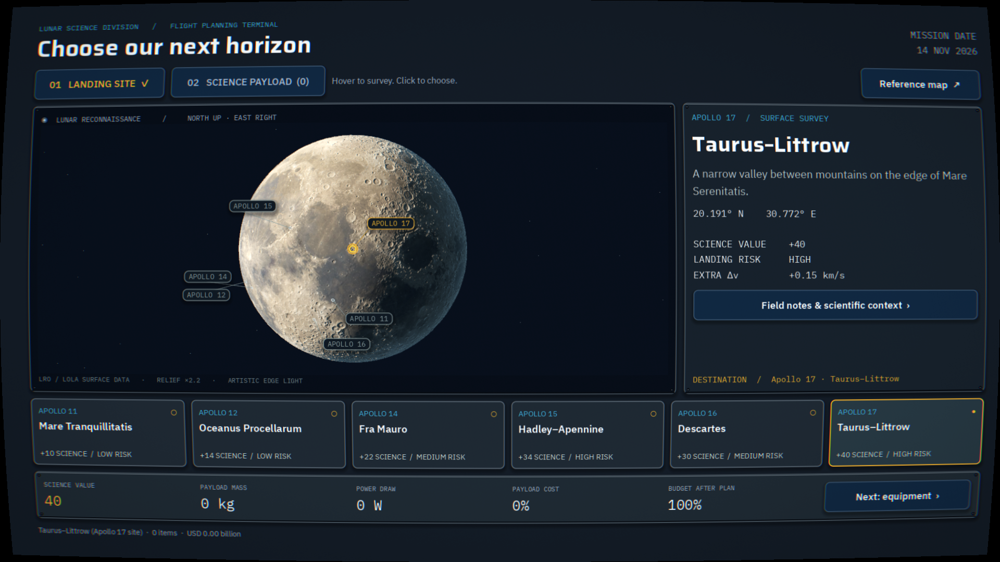
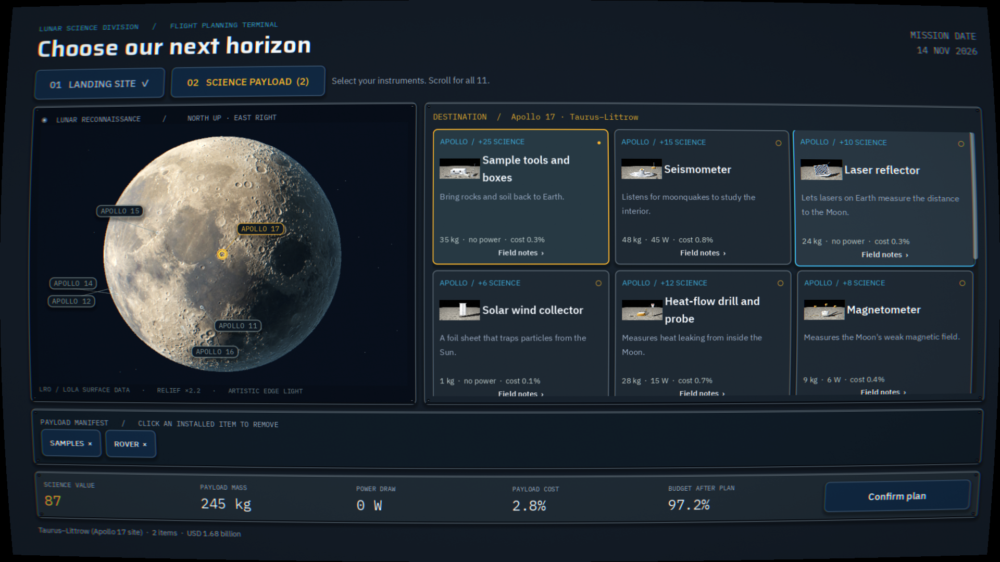

# Phase 3: lunar science planner

Implemented against `master_prompt3.md`, building on the manually approved
Phases 1 and 2. Phase 3 was subsequently approved; the next implementation is
documented in [phase4.md](phase4.md).

## Result

The science planner now contains a genuine 3D Moon in a fixed world coordinate
system, an orbital survey camera, six geographic Apollo markers, contextual site
inspection, and an instrument rack connected to the same destination. The graphite
terminal trim, restrained stars, cyan previews, amber selection and tactile cards
follow the supplied references without copying their artwork. Screenshots below
are actual Godot renders through the existing global CRT compositor.





## Files and responsibilities

| Change | Files |
| --- | --- |
| Replaced the original screen presentation; retained local choices and original commit boundary | `screens/science_plan/science_plan.gd`, `science_plan.tscn` |
| New terminal layout and embedded 3D viewport | `screens/science_plan/science_planner_ui.gd` |
| Reuse the original educational reader with CRT-safe margins and reduced-motion support | `screens/science_plan/planner_read_more.gd` |
| Fixed Moon, lighting, stars and depth-tested markers | `environments/lunar/lunar_scene.gd`, `lunar_scene.tscn` |
| Geographic direction/UV and conservative sphere occlusion | `environments/lunar/lunar_coordinates.gd` |
| Retargetable orbital camera | `environments/lunar/orbit_camera_controller.gd` |
| Projected site callouts | `environments/lunar/lunar_annotations.gd` |
| Surface color, numeric elevation, displaced silhouette and fine relief normals | `shaders/lunar/lunar_surface.gdshader` |
| Tactile site/instrument cards, animated numbers, physical terminal trim | `ui/components/planner_card.gd`, `animated_value.gd`, `terminal_panel.gd` |
| NASA maps, attribution and reproducible numeric conversion | `assets/moon/lroc_color_2k.jpg`, `lola_height_2k.png`, `README.md`, `prepare_height.py` |
| Integration checks and isolated manual preview | `tests/phase3_smoke.gd`, `phase3_preview.gd` |
| Implementation notes and actual screenshots | `docs/phase3.md`, `docs/phase3/*.png`; Phase 2 document status link |

Godot also generates accompanying `.uid` and texture `.import` files. The height
texture explicitly disables automatic lossy 3D compression to preserve its numeric
channels. No gameplay data, simulation, scientific calculations, earlier scene
routes, CRT shader, display settings, or approved headquarters code changed in
this milestone.

## Rendering and geographic alignment

The screen renders a dedicated, isolated `World3D` into one `SubViewport` and
displays its texture beneath native UI controls. The existing presentation shell
then applies the approved CRT effect once to the complete screen. No additional
global compositor or mouse-coordinate transform was introduced.

The Moon is a cached `SphereMesh` with 256 radial segments and 128 rings. NASA's
CGI Moon Kit provides matching 2048×1024 color and LOLA elevation textures. Small
vertex displacement contributes to the silhouette; finite differences of the
same elevation field produce fine crater normals. Matte shading, warm highlands,
slate maria, a fixed directional sun, restrained ambient fill and an artistic cool
edge light create separation. Relief is exaggerated 2.2×; the edge light is on
the surface and does not represent an atmosphere. Illumination is an art-directed
survey presentation, not the simulated mission date's solar geometry. Sources,
usage terms and elevation units are documented in `assets/moon/README.md`.

The axes are north **+Y**, prime meridian **+Z**, east **+X**. For latitude φ and
east-positive longitude λ:

```text
direction = (cos φ sin λ, sin φ, cos φ cos λ)
u = 0.5 + atan2(direction.x, direction.z) / (2π)
v = 0.5 - asin(direction.y) / π
```

Both the CPU marker/camera mapping and GPU surface shader use this convention.
The NASA map places longitude 0° at its centre and north at the top. Increasing
east longitude moves right on the map. The original JSON provides every Apollo
coordinate; no replacement coordinates are stored in the scene. The actual map
was inspected for recognizable Imbrium, Serenitatis, Procellarum and Tycho
structure. An independent geographic pixel check verifies bright Tycho against
dark Serenitatis; end-to-end checks focus every actual site marker at the camera
centre. The sphere's built-in UV orientation is bypassed entirely.

Marker meshes use normal 3D depth testing. Projected labels additionally require
`normal · camera_position > radius + safety_margin`, so labels on the far side
or close to the limb disappear even when their projection remains in the camera
frustum. This is conservative sphere/topography occlusion, not per-pixel terrain
ray casting. Current Apollo views remain comfortably away from the limb.

## Camera and interaction

The Moon transform never changes. The camera interpolates **unit orbital
directions with spherical interpolation**, at a constant radius of 8.5 units.
Cubic smoothstep eases its 0.85-second travel. Retargeting starts from the current
direction immediately and replaces the previous destination. North is projected
onto the camera tangent plane, with a deterministic polar fallback for stable
roll. The smaller viewport dimension controls framing, keeping the globe visible
when the payload rack narrows the view.

Hover or keyboard focus waits 0.14 seconds before previewing. Passing over a card
cancels the pending request; clicking bypasses the wait and selects immediately.
The preview marker is cyan, the committed destination stays amber, and inactive
markers remain small. A very slow, small-angle overview orbit stops permanently
on the first site interaction. Reduced motion disables that drift and snaps
camera targets, UI reveals and numerical changes.

All pointer input goes through the existing CRT mapping into native buttons.
No separate 3D picking convention is needed. Global screen drift and site-based
orbital motion remain independent.

## Instruments and preserved behavior

The equipment step retains the live Moon, chosen region and persistent marker.
All eleven original instruments have illustrations, full short descriptions,
mass, power, cost, science, era, selection state and field notes. Their existing
game illustrations are reused; there are no new 3D instrument models. The rack
scrolls to the final instruments. Installed items appear in a manifest and can
be removed there or on their cards. Shared spring motion, reveal transitions
and interruptible number interpolation provide feedback.

The controller's `_site_index` and `_picked` are provisional UI choices, just as
in the original screen. `Campaign.plan_totals()` supplies every displayed total;
interpolation is presentation only. Returning between steps retains choices.
Site selection, hover, instrument toggles, reference-map actions and educational
notes never charge the budget or advance campaign time/stages.

`Campaign.set_science_plan()` is called only once on final confirmation. The
original cost, base 45 days plus 10 per instrument, stage 5, campaign clock,
0.6-second confirmation delay and 0.6-second HQ route fade are retained. A guard
prevents duplicate confirmation. Zero instruments and the original affordability
behavior remain allowed. All original long-form text, facts, illustrations and
source attribution remain in the original Read More system; explicit field-note
buttons replace the floating offer chip in this screen. The original clickable
near-side reference map is also retained.

## Verification

Executed with **Godot 4.7.2 stable**, Windows, Forward+ / D3D12, RTX 3060:

- Headless editor import and script/scene loading: passed without Godot errors.
- Original `simulation_regression.gd`: passed unchanged deterministic outcomes,
  replay, overrides and site totals against the pre-overhaul fixture.
- Original `settings_regression.gd`: passed migration/round-trip/sanitization.
- Rendered `presentation_smoke.gd`: passed all twelve routes, curved input,
  keyboard, dragging, dialogs, composition and embedded 3D.
- Rendered `phase2_smoke.gd`: passed parallax, native window modes, menu,
  headquarters, all eleven stage gates and return flow.
- `phase3_smoke.gd`: passed headless and rendered. Covers all six hovered sites,
  centred geographic targets, constant-radius travel, fixed Moon transform,
  debounce/rapid retargeting, label occlusion, persistent destination, notes,
  eleven instruments, scrolling, manifest removal, exact totals, step retention,
  zero-instrument confirmation availability, CRT disabled/maximum curvature/live
  drift/reduced motion, actual 1280×720 and 1600×900 native windows, 1920×1080
  borderless presentation, and a single campaign commit/HQ return. A requested
  1920×1080 decorated window is correctly clamped to 1904×1040 on this desktop.
- Actual overview, site, payload and educational-panel renders inspected.

A short 120-frame, uncapped local rendered measurement at the end of the Phase 3
suite produced **1.49 ms median / 1.84 ms p95 frame intervals**. This
is a local observation, not a guarantee for other hardware. No long-session,
integrated-GPU or non-Windows performance result is claimed. Meshes/materials,
surface maps, star geometry and label styles are cached; there is no continuous
mesh rebuilding or per-frame resource loading.

## Manual review

From the repository directory, run the isolated preview through the real CRT:

```powershell
& "path\to\Godot_v4.7.2-stable_win64_console.exe" --path . --script tests/phase3_preview.gd
```

This creates an in-memory stage-4 campaign in that process. It does not save
player preferences. Alternatively progress normally through the existing game
to the science-planning stage. F6 on `screens/science_plan/science_plan.tscn`
previews the scene directly, but bypasses the global CRT shell.

1. Hover each Apollo card; rapidly pass across several and then settle. Check
   camera easing, north-up geography, crater detail and marker readability.
2. Click one destination, then hover another. The selected destination remains
   amber while the other is previewed in cyan. Open field notes and the map.
3. Continue to the equipment rack. Scroll through all eleven options; open the
   last instrument's notes, add/remove equipment and use the manifest.
4. Return to sites, change the destination and return to payload. Check retained
   instruments and all totals. Confirm once and check the original HQ return.
5. Check your preferred CRT intensity, movement, display mode, keyboard focus and
   reduced-motion setting using the existing settings screen.

The preview can generate screenshots and exit with `-- --capture`. Automated
checks use `--script tests/phase3_smoke.gd`; add `--headless` for logic/input checks
without rendering. Tests do not save display preferences.

Phase 3 was manually approved before the Phase 4 implementation began.
Low-end hardware, unusual DPI/multi-monitor combinations, gamepad navigation and
extended play remain manual validation items. Instrument visualization uses
existing illustrations rather than new 3D models; none of the gameplay choices
are placeholders. Phase 4 is documented separately in [phase4.md](phase4.md).
