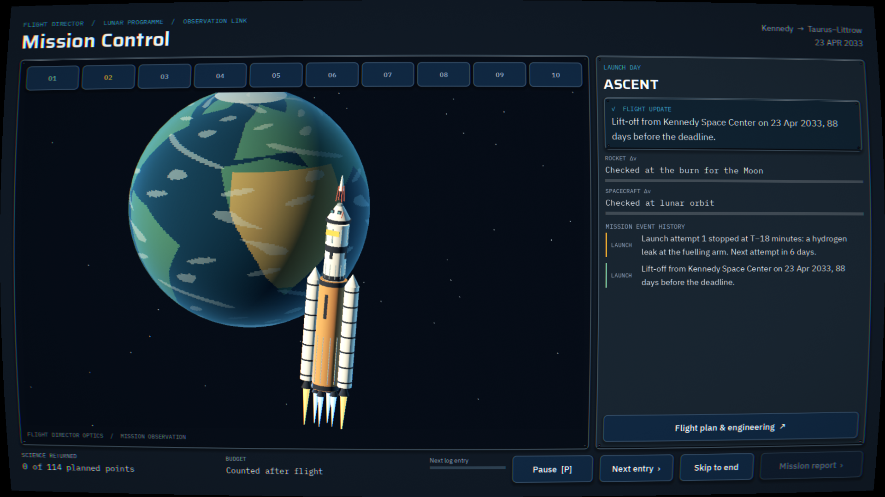
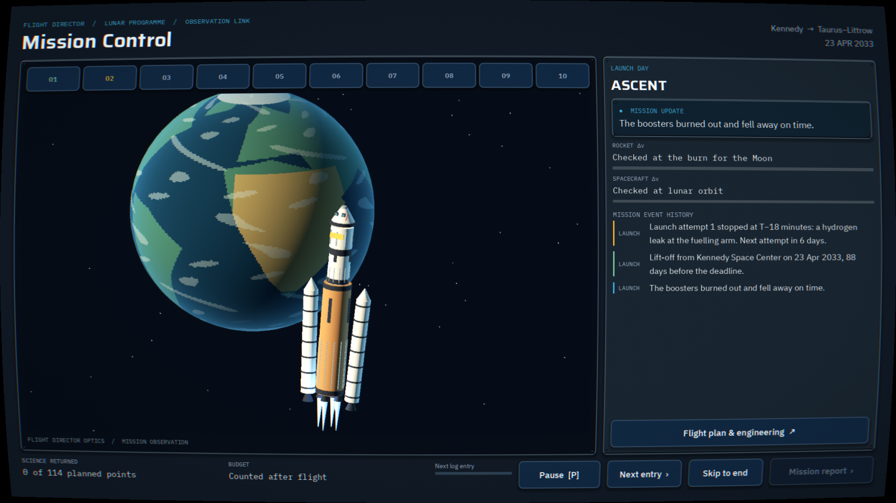
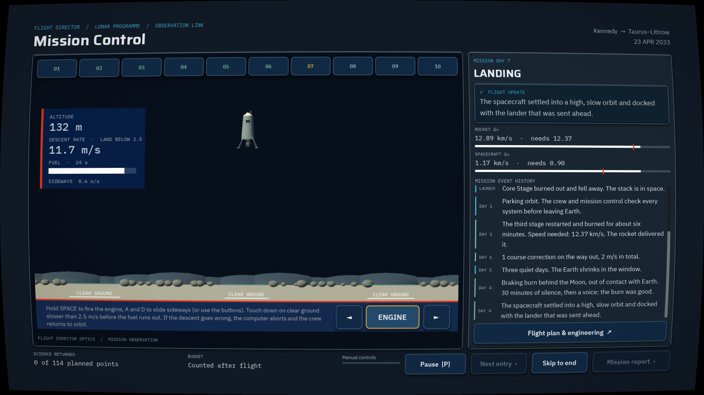
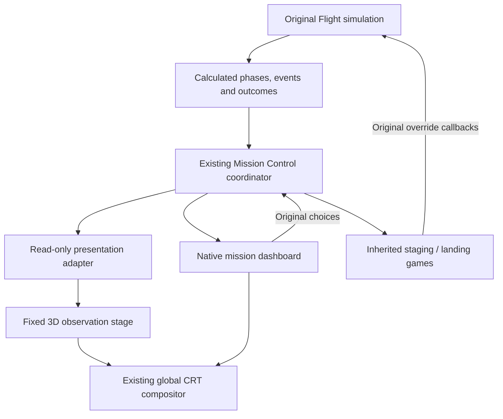

# Phase 4: cinematic Mission Control

Implemented from `master_prompt4.md`, on the existing `visual-overhaul` branch.
Phases 1–3 remain intact. Vehicle Assembly and Phase 5 are outside this milestone.

## Result and review images

Mission Control now presents the selected rocket/spacecraft as a modular 3D
object against an authored Earth, deep-space or lunar environment. One fixed
observation camera serves normal flight. Local engine effects, physical stage
separation and spacecraft configurations communicate progress; a right-hand
terminal presents the original log entries, decisions, warnings and telemetry.







These are actual rendered game images through the approved CRT compositor.

## Behavioral audit and preservation

Before editing, the original flight regression suite passed. The original
Mission Control source and SHA-256 hashes of the flight/campaign/vehicle/
operations models, data and both minigames were recorded in ignored local test
artifacts. Those model/data/minigame source files remain **byte-for-byte
unchanged**, as does `flight_view.gd` and the original final report.

The inspected behavioral contracts were retained:

- Entry uses the original `Flight.quick_start()` fallback and calls `Flight.fly()`
  at campaign stage 10; replaying an already calculated stage-11 flight uses the
  existing result. Rendering never calls the simulation.
- `_step()` preserves phase order, original introduction/read durations, line
  ordering, phase completion, launch gating and finish behavior. All ten phases
  remain available; a failed flight retains the original shortened phase list.
- The only original choice gates are start, manual/automatic staging at launch,
  and manual/automatic landing when available. No emergency choices or invented
  gameplay events were added. Existing failures without choices remain warnings
  followed by the original flight rules.
- Original staging timing errors and landing result dictionaries reach the
  existing callbacks and `_refly()` override path. This is the only existing
  interaction-driven replay of `Flight.fly()`; it remains deterministic.
- Pause, resume, next-entry, skip, escape-to-HQ and the final report button retain
  their original meaning. Skip preserves the original precomputed automatic path
  when bypassing an unfinished manual interaction.
- Campaign dates, costs, science, objectives, causes, outcomes and progression
  remain the original simulation's responsibility.

Two integration corrections concern presentation/input only: if a minigame's
original completion-delay signal arrives during pause, its result waits for
resume before being applied; virtual pointer thrust/steering holds are cleared
on pause to avoid a missed mouse release. Both minigames' original physics,
thresholds, seeded terrain, timing calculations and outcome code are inherited
without editing their source.

## Important files

| Responsibility | Files |
| --- | --- |
| Existing coordinator, with new presentation bindings and preserved flow | **Modified** `screens/flight/mission_control.gd` |
| Native tactile dashboard, decisions, history and engineering drawer | `screens/flight/mission_dashboard.gd` |
| Existing `FlightView` contract backed by a 3D viewport | `screens/flight/cinematic_flight_view.gd` |
| Read-only phase/log-to-visual adapter | `screens/flight/mission_presentation.gd` |
| Modular original low-poly models from actual selected parts | `environments/flight/spacecraft_models.gd` |
| Poses, engines, thrusters, separation, heating, parachutes and recovery | `environments/flight/spacecraft_visual.gd` |
| Fixed camera, lights, stars and authored planetary/surface contexts | `environments/flight/space_stage.gd`, `space_stage.tscn` |
| Stylized Earth and reuse of Phase 3 lunar materials | `environments/flight/planet_factory.gd`, `shaders/flight/earth.gdshader` |
| Responsive staging skin, inheriting original mechanics | `screens/flight/cinematic_staging_game.gd` |
| Original landing gameplay with 3D observation and original HUD information | `screens/flight/cinematic_landing_game.gd`, `environments/flight/landing_observation.gd` |
| Isolated interactive preview and integration checks | `tests/phase4_preview.gd`, `tests/phase4_smoke.gd` |
| Report and review screenshots, excluded from Godot resource import | `docs/phase4.md`, `docs/phase4/`; Phase 3 status link |

Godot-generated `.uid` companions accompany the new scripts/shader. The existing
Mission Control `.tscn` route remains in use; its frame hosts the new layout.
No approved CRT, settings, headquarters, science-planning or assembly code changed.

## Architecture and fixed camera



The main `Camera3D` is placed and aimed once in `SpaceflightStage._ready()`.
It stays orthographic at size 14, with an unchanged transform. No flight,
pointer, phase, vibration, parallax or animation code moves it. The scene uses
authored display poses/scales rather than tracking a physical trajectory. This
keeps both the full launch vehicle and smaller spacecraft readable while the
camera and overall observation composition remain stable. Scene proportions
are illustrative, not physical orbital scale.

The original 2D `FlightView` remains available in the engineering drawer,
including its original trajectory data, magnified views and explanatory phase
information. The new `CinematicFlightView` inherits its public staging/progress
contract but renders an isolated `World3D` instead. It does not draw the old
rocket sprites underneath the new spacecraft.

Normal flight uses one local 3D viewport under native UI. The existing global
presentation shell applies the CRT effect once to the whole screen and forwards
input with its existing mapping. No second CRT shader or pointer transform was
introduced. The manual landing has a dedicated **fixed-angle** 3D view, permitted
by the specification; the normal stage's viewport is disabled while that view
is active and restored afterwards.

## Models and effects

The model factory reads `Vehicle.chosen()` and selected IDs. It distinguishes
serial first stages versus two side boosters, engine clusters, the large core,
upper-stage/twin-engine configurations, capsule sizes, escape-tower presence,
standard/light/extended/HLS landers, selected solar power and communications.
The HLS option is absent from the launch stack because the existing high-orbit
flight sends that lander ahead. Interior systems are not given invented exterior
parts. Model dimensions and proportions are deliberately stylized.

Engine nozzles carry cached tapered exhaust meshes, fuel-dependent color and a
single local light. Ignition/shutdown change their extent and lighting; subtle
vibration affects only the launch assembly. Side boosters peel apart separately;
serial stages detach and drift away. Hardware stays owned by the visual scene
and can be restored to cached assembly transforms on reconstruction. Pose
tweens are replaced when retargeted; skip/finish settles them and hides debris.

Course-correction entries trigger brief thruster pulses. Power and antenna
failure entries produce corresponding safing/antenna changes. Re-entry heating,
the reported parachutes and recovery use the actual original event entries.
Failures stop the affected burn; no-launch stays intact, a crew escape becomes
the capsule/recovery configuration, and crew loss never becomes a successful
recovery. No generic explosion is substituted for every failure.

The adapter uses existing structured fields (`phase.id`, `phase.fail`, line
kind/view hints) and a small set of explicit English event-template matches for
mechanical details not separately tagged by the original engine. Visual keys
combine phase ID, line index and text, preventing duplicate effects. Translating
or changing those templates in future requires updating this presentation-only
mapping; broad warning text still comes directly from the original log.

Earth uses original hand-authored simplified continent contours and a restrained
surface-edge shader. Lunar orbit reuses the approved Phase 3 LROC/LOLA material
and existing attribution in `assets/moon/README.md`. Surface operations use a
small authored terrain stage with Earth in the distance. Experiment cases appear
only for retained instruments actually represented by positive science rows;
window observations do not deploy imaginary surface equipment. Stars stay fixed.

## Dashboard and minigames

The scene occupies approximately two thirds of the main horizontal layout.
The dashboard prioritizes current phase, latest actual event, warnings and
choices; telemetry and scrollable history occupy the monitoring state. The
engineering drawer retains all ten phase explanations, vehicle facts,
objectives and the original navigation visualization. Event stamps use the
original phase day, not fabricated telemetry or clock times. History follows
new entries until the player scrolls back.

Staging retains `BURN = 6.5`, the 1.5-second late limit, timing gains/losses,
Space/Enter/button controls and original result emission. Its skin fits the
dashboard while the physical rocket remains visible. Landing retains the exact
gravity, thrust, lateral acceleration, fuel, alarms, clear-ground checks,
touchdown thresholds and abort calculations. Its 3D lander and terrain read the
original `_x`, `_height`, `_engine`, `_push`, seeded rocks and clear zones.
The original 1020×600 projection and HUD information are retained; graphics
never participate in collision or outcome decisions.

Pause disables the bound stage/minigame processing and animation. Reduced
motion settles cosmetic poses and separation, removes plume/vibration variation
and respects the shared UI settings. Essential player-controlled landing motion
continues normally when the game is running.

## Validation status

**Implemented and automatically exercised** with Godot 4.7.2 stable, Windows,
Forward+ / D3D12, RTX 3060:

- Original deterministic simulation and settings regression suites pass.
- Phase 1 rendered suite passes: all twelve routes, CRT input/composition,
  keyboard, dragging, dialogs and embedded 3D.
- Phase 2 rendered suite passes: screen drift, actual display modes, menu,
  headquarters, all eleven stage gates and return flow.
- Phase 3 rendered suite passes: all Apollo sites, camera/occlusion, instrument
  selection, original totals, notes, display scaling and single confirmation.
- Phase 4 passes headless and rendered: full ten-phase flight in one screen,
  original event order/count, fixed camera, selected hardware, distinct engine
  nozzles, no-launch, first/second-stage faults, failed restart, lunar-engine
  failure, power/comms failure and crew loss without escape equipment.
- Native staging keys/buttons, early/late penalties, exactly-once callbacks, paused separation and
  deferred completion are exercised. Successful and aborted manual landings are
  compared against the **untouched original LandingGame** under identical
  starting state/inputs, including matching fuel/speed/outcome and sampled
  position/velocity/alarm state. Their original `Flight.fly()` consequences are
  also checked against deterministic replay.
- Actual dashboard clicks pass with CRT disabled, maximum curvature/live screen
  drift and reduced motion. 720p/900p/windowed layout, borderless presentation,
  skip/reconstruction and the final report transition are exercised. Mode
  availability/migration remain covered by the approved Phase 2 suite.
- Original simulation/data/minigame file hashes remain unchanged. Import and
  test logs are checked for Godot errors; `git diff --check` passes.

**Rendered and visually inspected:** full launch vehicle, ignition, separation,
Earth/deep-space/lunar configurations, surface stage, dashboard choices/history,
manual staging pause, manual landing and final outcomes. Review screenshots are
included above. This is not a claim of the user's manual approval.

The uncapped local 120-frame launch-assembly benchmark, including engines and
the CRT, recorded **2.83 ms median / 7.09 ms p95 frame intervals** on the RTX 3060.
It is printed by `phase4_smoke.gd`. This is a short local measurement rather
than a hardware guarantee. Cached geometry/materials, sparse stars, one engine
light and simple mesh effects avoid particle/ray-tracing/volumetric costs.

## Manual review and limits

Run the isolated preview from the repository directory:

```powershell
& "path\to\Godot_v4.7.2-stable_win64_console.exe" --path . --script tests/phase4_preview.gd
```

This creates a fresh in-memory test campaign in that process, using the existing
quick-start configuration. It does not save preferences or change the normal
campaign entry route. Play the existing campaign normally to review your own
vehicle. Add `-- --capture` to render an automatic screenshot walkthrough and
exit. `--script tests/phase4_smoke.gd` runs the integration checks; `--headless`
also works. F6 on the original Mission Control scene bypasses the global CRT.

For review:

1. Start, pause/resume with P, advance entries, inspect the full engineering
   drawer and scroll back in the event history.
2. Choose manual staging. Watch the selected stages while using Space or the
   button; compare early/late timing and pause during separation.
3. Choose manual landing. Test keyboard and pointer holds, releasing outside
   the screen, pause/resume and both touchdown/abort paths.
4. Use different vehicle silhouettes and original failure cases. Check warnings,
   final science/objectives and the unchanged report.
5. Review preferred CRT intensity/drift and display modes at 720p–1080p.

**Requires manual validation:** artistic approval/pacing, long real-time soak
runs, unusual DPI/multi-monitor setups, lower-end/integrated GPUs and controller
navigation. Automated complete-flight paths advance entries without restarting
the screen; they do not substitute for a long real-time player session.

**Deliberate visual limits:** spacecraft proportions and observation poses are
illustrative; secondary service/interior hardware shares simplified geometry.
Surface experiments use stylized cases rather than individually detailed 3D
instruments. Abort/recovery reconfiguration is schematic rather than a complete
mechanical reconstruction of every real spacecraft. New audio assets were not
added; the presentation-event and engine methods are suitable attachment points.
These limits do not remove gameplay choices or change outcomes. No production
cheats or fake mission events were introduced; injected latent-fault fixtures and
test pilots exist only in the test script.

Phase 4 is ready for manual review. **Phase 5 has not been started.**
