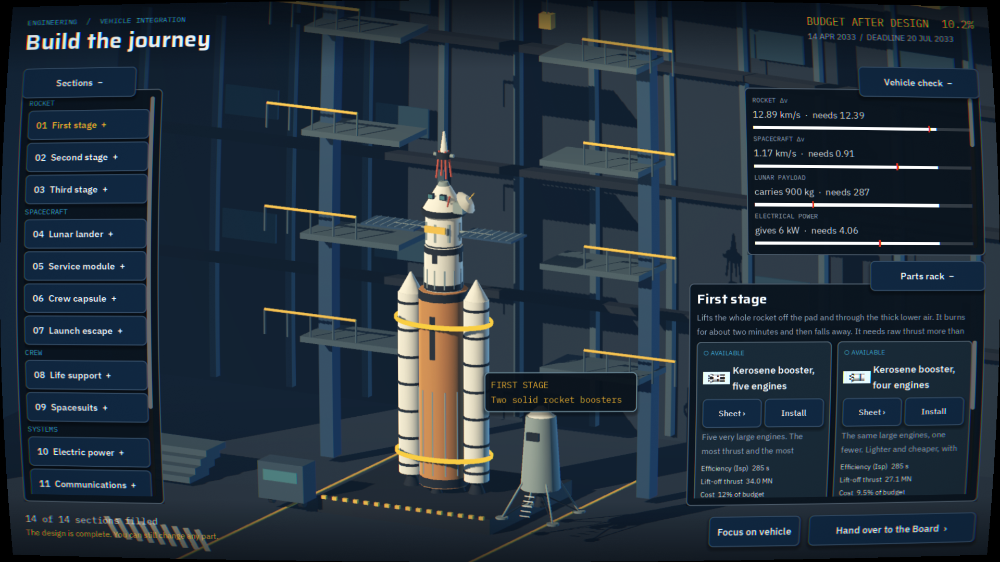
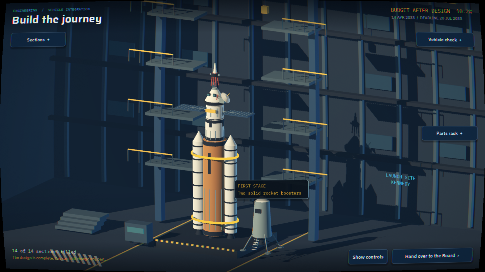
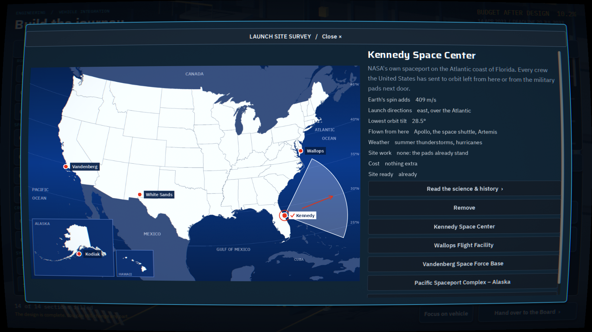

# Phase 5: fullscreen Vehicle Assembly

Implemented from `master_prompt5.md` in the existing `visual-overhaul` working
tree. Phase 6 has not started. Mission Control retains its approved Phase 4 layout.

## Result and rendered review

Engineering now opens onto a full-screen, original low-poly integration hangar.
A vertical modular rocket stands between catwalks, a suspended crane, equipment
carts and marked work bays. Cool structural materials and amber rails separate
the bright vehicle from the building. Shadowing, depth fog, a moving crane hook
and a softly pulsing work beacon give the hall depth and restrained ambient life.
An open camera-facing wall keeps the scene continuous beneath the overlays.







[Rendered full technical sheet](phase5/technical-sheet.png).

These are actual Godot Forward+/D3D12 renders through the existing global CRT,
not concept images. Additional native resolution/warning captures are generated
by the integration test under ignored `.godot/phase5-test-*.png` paths.

## Architecture and important files

| Responsibility | Files |
| --- | --- |
| Original draft, evaluation, navigation and handover coordinator with new presentation bindings | **Modified** `screens/engineering/vehicle_assembly.gd` |
| Existing route, now a full-rect root instead of the old photograph/frame/2D stack | **Modified** `screens/engineering/vehicle_assembly.tscn` |
| Reusable full-bleed 3D viewport and native overlay layer | `systems/rendering/immersive_scene_shell.gd` |
| Reusable edge panel with a stationary reopening tab | `ui/components/retractable_panel.gd` |
| Springy illustrated part cards, explicit Install/Remove and technical sheet actions | `ui/components/assembly_option_card.gd` |
| Floating section list, metrics, parts rack, sheets and persistent footer | `screens/engineering/assembly_overlay.gd` |
| CRT-compatible ray picking of visible rocket modules | `screens/engineering/assembly_picking.gd` |
| Authored hall, lighting, ambient movement and height-sensitive camera framing | `environments/assembly/assembly_hangar.gd`, `.tscn` |
| Draft-to-modular-rocket adapter, provisional previews, cached variants, locators and installation/removal motion | `environments/assembly/assembly_rocket.gd` |
| Isolated interactive preview and integration tests | `tests/phase5_preview.gd`, `tests/phase5_smoke.gd` |

`ImmersiveSceneShell` is local to a routed screen. It owns an isolated 3D
`SubViewport`, a full-rect texture display, and a full-rect overlay control. Panel
collapse never changes the world rectangle. The outer `PresentationShell`
continues to own the only CRT pass, overscan, native UI rendering, screen drift
and pointer remapping. The local shell introduces no second shader or second
pointer warp. Ray picking converts the already-corrected logical position into
the local 3D viewport before projecting a camera ray.

The shell does not know about campaign stages or vehicle data. Future Mission
Control work can attach its existing world and dashboard as world/overlay
children and reuse the retractable panels. No Mission Control migration or
event-controller rewrite was performed in this milestone.

## Rocket mapping and interaction

The rocket adapter reads the existing slot/part dictionaries and reuses the
unchanged `SpacecraftModels` factory from Phase 4. Assembly-specific proportions
and accessories are added locally; the flight factory is not edited.

| Actual selections | Assembly representation |
| --- | --- |
| First stage | Selected engine cluster, tapered/straight body, or paired side boosters |
| Second stage | Selected cluster and ordinary stage or tall orange core |
| Third stage | One/two engines, smaller ICPS body, storable-propellant tank band |
| Lander | Selected conventional lander in the stack, or HLS in a separate delivery work bay |
| Service module | Full/short/compact body or longer insulated cryogenic tanks |
| Capsule | Selected two-, three- or four-person capsule |
| Escape | Ordinary/steerable tower, capsule-mounted abort pods, or no escape hardware |
| Power | Selected solar arrays, fuel-cell packs or battery packs as an inspection view |
| Communications | Fixed aerials, dish, dish plus relay equipment, or dish plus optical terminal |
| Life support / suits | Capsule or equipment-cart locator and the actual selected-part callout; internal systems remain represented by their data |
| Launch site / ground / tests | Original site map, installed-site sign and ground-equipment locator; no invented mission hardware |

Unfilled major bays show thin construction guides, not auto-selected parts.
The initial empty draft therefore remains truly empty. Module dimensions are
stylized visual proportions, not a second mass or engineering model.

[Rendered empty-draft construction guides](phase5/empty-draft.png).

Selecting a section places amber locator rings around the corresponding area;
clicking a visible major module selects its section. Hover or keyboard focus on
a card briefly previews that candidate in cyan, names what it would replace, and
restores the actual vehicle on exit. Previews never write the draft or change
metrics. Installing lowers the new component into place with a short spring;
removing lifts and shrinks the outgoing component before hiding it. Each new
change cancels previous visual motion and hides stale cached variants. The
camera adjusts its framing for tall combinations without introducing orbit
controls. Reduced motion settles panels, framing, modules and ambient props.

## Floating UI and preserved flow

- All **14 sections and 52 original options** remain available. The left list
  scrolls through Rocket, Spacecraft, Crew, Systems and Ground groups. Installed
  sections carry a `+` and show the selected part in their tooltip.
- Section, metrics and parts panels retract independently to fixed native tabs.
  **Focus on vehicle** retracts all three; the tabs, budget, progress and handover
  remain accessible. Edge fades keep header/footer text readable over the hall.
- Cards expose the original illustration, name, short description, cost/build
  time and relevant performance specs. Explicit actions appear near the top.
  **Sheet** exposes every original spec and the complete description in a
  scrolling technical sheet with fixed actions. Illustrated science/history
  notes still use the existing `ReadMore` implementation and original content.
- The metrics panel scrolls through all original speed, payload, power, mass,
  TWR, propellant, crew, duration, supplies, EVA, cost, workforce and readiness
  figures, plus predicted reliability. Four gauges interpolate already-evaluated
  values for 0.24 seconds and settle to the original number formats. Reliability
  uses the shared animated-value component. No formulas run in the visual layer.
- The original five-site `LaunchMap` retains its coordinates, launch-direction
  fan, orbit-tilt information and click targets. Inspecting a dot previews a site;
  **Launch from here** installs it. Site specs, science/history and removal remain
  available. The hangar sign names the installed site, not the surveyed one.
- Original empty-slot auto-next, click-on-installed-card behavior, explicit
  removal, draft retention on Esc/HQ return, and handover return to HQ remain.
  Escape closes notes/sheets/site survey before leaving the screen.

## Engineering and simulation preservation

`Vehicle.draft` remains the existing live draft reference. `Vehicle.evaluate()`
is still the sole source of engineering values; `Vehicle.shortfalls()` supplies
advisories. The renderer works on copies and never writes campaign, simulation
or committed vehicle state.

The original handover gate is retained: all sections must be assigned and the
design must be affordable. **Advisories do not add new blocking rules.** Handover
calls the original `Vehicle.hand_over()` exactly once, advances to stage 7,
charges the original evaluated cost, resumes the clock and returns to HQ. It
does not invent a build-time charge. A coordinator guard prevents duplicate or
disabled-button commits.

Before this milestone, the simulation suite passed and SHA-256 baselines were
recorded. The following ten files remain byte-for-byte unchanged from that
baseline: `autoload/{vehicle,campaign,flight,operations}.gd`,
`data/{vehicle,campaign,operations}.json`, `screens/flight/mission_control.gd`,
`screens/engineering/{rocket_stack,launch_map}.gd`. Existing mechanics, data,
scientific calculations and flight consequences were not rewritten.

## Verification

Tested with Godot **4.7.2 stable**, Windows Forward+/D3D12, RTX 3060. The dedicated
Phase 5 suite passes headless and with the actual native renderer. It exercises:

- Empty draft and construction guides; original delayed auto-next; draft versus
  committed-state isolation; all 14 sections and 52 options/specification sheets.
- Read-only previews, rapid replacement, cancellation, no duplicate variants,
  settled transforms, real card hover/exit, nested Sheet/Install/Remove actions,
  original illustrated notes, and 3D second-stage ray picking.
- All five native map-dot targets, survey versus installation, scrolling long
  site sheets into view, actual site installation and chosen-site map state.
- Warning-producing catalogue selections (including cabin suits, low power and
  an overland range), exact authoritative gauge targets/settled text, TWR/date
  formatting, affordable advisories, and incomplete/unaffordable commit guards.
- Collapse/reopen through zero/maximum CRT curvature, disabled CRT, maximum
  screen drift and reduced motion; unchanged full-bleed geometry; actual 720p,
  900p, 1080p windowed mode and borderless/exclusive fullscreen input.
- Esc to HQ with draft retained, re-entry, and one-time handover with exact
  design, stats, cost, original time behavior, progression and HQ route.

The 1080p *decorated window* is constrained by this desktop's work area to
1904×1040; borderless/exclusive modes use the full 1920×1080 display. Requested
1280×720 and 1600×900 window sizes are applied natively.

The dedicated native test's 120 uncapped local frame intervals measured about
**1.5 ms median / 1.8 ms p95**. This is a local CPU/frame-interval smoke measure,
not a GPU benchmark or a performance guarantee for other machines.

Also passed during this milestone: original simulation and settings regressions,
native Phase 1 composition/input/all-route checks, Phase 2 HQ/stage/display
checks, native Phase 3 Moon/planner checks, and native Phase 4 full Mission
Control/failure/manual-staging/manual-landing/report checks. Editor import and
`git diff --check` complete without errors.

## Preview and repeatable checks

Use an installed Godot 4.7 console executable from this project directory:

```powershell
godot --headless --editor --path . --quit
godot --path . --script tests/phase5_preview.gd
godot --path . --script tests/phase5_preview.gd -- --empty
godot --path . --script tests/phase5_preview.gd -- --capture
godot --headless --path . --script tests/phase5_smoke.gd
godot --path . --script tests/phase5_smoke.gd
godot --headless --path . --script tests/simulation_regression.gd
godot --headless --path . --script tests/settings_regression.gd
```

The preview creates an isolated in-memory stage-6 fixture with an 80% available
budget, either a real catalogue configuration or an empty draft. It does not
write saved preferences. `--capture` exits after recording actual native renders
in `.godot/phase5-*.png`. Normal campaign entry still uses the existing Engineering
route and the player's actual draft, budget and stage.

For review, hover several parts, install/remove them, select physical modules,
scroll all section/metric/card lists, open Sheet and science/history, retract and
reopen each panel, and inspect all five map dots before installing a site. Try a
tall liquid-first-stage/core-second-stage combination and a short solid-booster
configuration. Test both a fresh draft and an existing campaign's draft return.

## Limits and review boundary

The hangar and spacecraft are original primitive-based stylized art, not imported
production CAD models. Internal crew systems use contextual locators rather than
exploded mechanical internals; the HLS is deliberately displayed separately.
No new audio assets were introduced. Final review of artistic taste, other GPUs,
ultrawide layouts, touch/gamepad navigation and production exports remains manual;
the native tests cover the stated desktop/mouse 16:9 configurations. Metrics and
long catalogues intentionally scroll rather than covering the entire vehicle.

This milestone is ready for review. No Phase 6 work, remote push or commit has
been performed.
