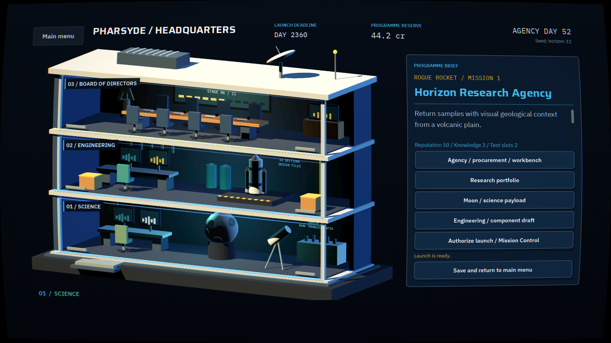
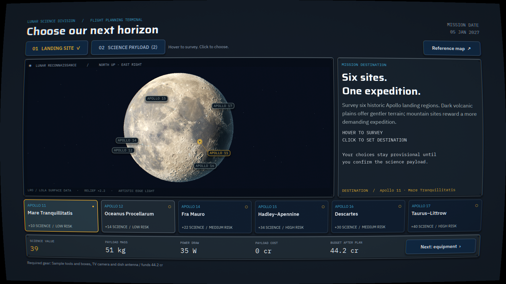
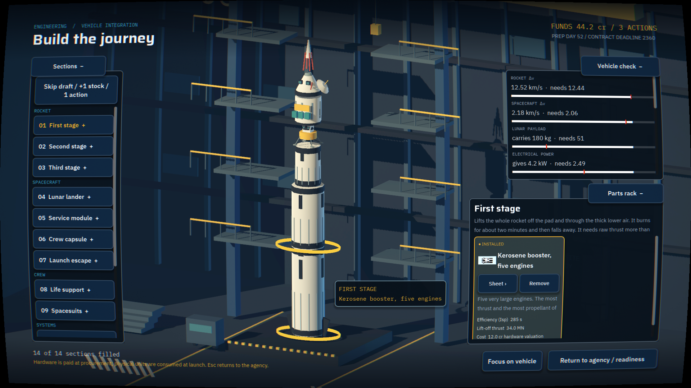
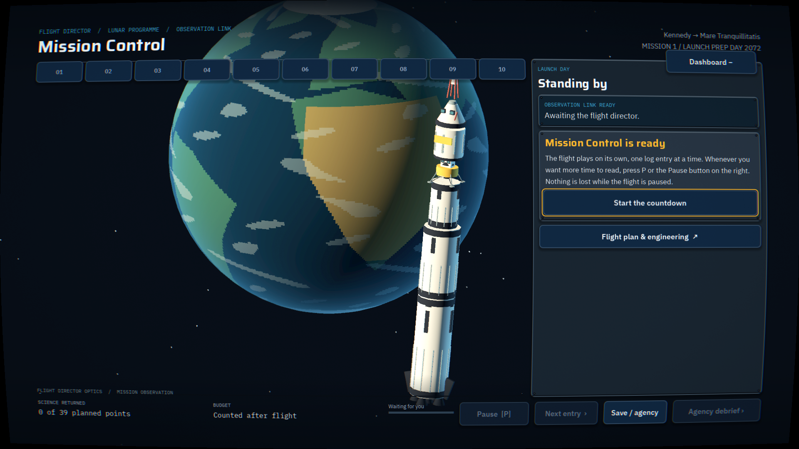

# Phase 5.5 — Project Rogue Rocket

Implemented from `master_prompt6.md`. That file calls this expansion **Phase 5.5**;
the later Phase 6 endings/report redesign has not started. This is a playable
vertical slice alongside the original Story Campaign.

## Checkpoint, repository and build

- Repository: [alm1ghtyf1tch/to-the-far-side-2.0](https://github.com/alm1ghtyf1tch/to-the-far-side-2.0).
- Development branch: `visual-overhaul`. Ownership and push permission were
  verified against the connected account before pushing.
- Verified Phases 1–5 checkpoint: [`98bad24`](https://github.com/alm1ghtyf1tch/to-the-far-side-2.0/commit/98bad24), pushed successfully.
- Export/workflow checkpoint: [`6a29ead`](https://github.com/alm1ghtyf1tch/to-the-far-side-2.0/commit/6a29ead).
- Initial stable macOS artifact: [successful build 44359785049](https://github.com/alm1ghtyf1tch/to-the-far-side-2.0/actions/runs/44359785049), artifact `ToTheFarSide-macOS-Dev`.
- The final gameplay commit and updated artifact are identified in the completion
  response and [development build workflow](https://github.com/alm1ghtyf1tch/to-the-far-side-2.0/actions/workflows/macos-dev.yml).
  Source commits exclude generated executables/archives, editor caches and secrets.

Local Mac output: `build/macos/ToTheFarSide-macOS-Dev.zip`. It contains a complete
Universal 2 application with ARM64/Intel slices, executable permissions, packaged
game data and built-in ad-hoc signatures. It is **not notarized**. The archive is
validated separately from launching it on macOS. No Mac hardware was available.

The original Windows preset remains available; a new Windows export and its
embedded pack were generated. The matching Godot runtime successfully exercised
bundled JSON, compiled models, procurement, original flight, the UI and save
handling from that pack. This is not a claim of a complete standalone Windows
export playthrough.

## Rendered review









These are actual native Godot renders through the existing CRT compositor.
They are not image-generation mockups. Scientific lunar textures/coordinates,
headquarters, spacecraft factories and the hangar reuse the completed phases.

## Mode architecture and important files

| Responsibility | Implementation |
| --- | --- |
| Programme selection and agency identity | `screens/roguelite/modes.gd`, `.tscn` |
| Persistent run/economy/actions/commands/evaluation | `systems/roguelite/rogue_run.gd` |
| Original-model projection and Story restoration | `systems/roguelite/rogue_bridge.gd` |
| Seeded curated content and original component lookups | `systems/roguelite/rogue_catalog.gd`, `data/roguelite/rules.json` |
| Compatible offers and reference procurement paths | `systems/roguelite/rogue_draft.gd` |
| Research portfolios and actual instrument/data gates | `systems/roguelite/rogue_research.gd` |
| Versioned atomic run save and backup recovery | `systems/roguelite/rogue_save.gd` |
| Existing visual screens extended for the run | `screens/roguelite/{agency_hq,assembly,science,control}.gd` and inherited scenes |
| Shared native tactile composition helpers | `ui/components/rogue_widgets.gd` |
| macOS/Windows presets, CI, archive checks | `export_presets.cfg`, `.github/workflows/macos-dev.yml`, `tools/validate_macos.py` |

The original Campaign, Vehicle, Operations and Flight source files are unchanged
from the checkpoint. A scoped adapter supplies run inputs to those models and
temporarily uses a copied component catalogue for qualified/reserve hardware.
Their existing rocket equation, mass, power, schedule, engineering checks,
preparation, latent defects, flight outcomes and replay remain authoritative.
Leaving Rogue restores the previous in-memory Story session and catalogue.
Story does not read Rogue economy data or write the Rogue save file.

Rogue screens inherit the approved controllers and scenes. The run's Mission
Control places the existing own-world flight viewport across the full screen,
with transparent observation space, a retractable dashboard, edge fades and
native overlays. Its camera stays fixed. Story Mission Control retains the
approved Phase 4 composition and original Skip action.

## Agency management

Create an agency name, one of four colour identities, a seed and one doctrine:

- **Science First:** initial knowledge and one extra first-mission science work
  period, with less starting money.
- **Engineering Innovation:** extra initial test capacity and access to
  experimental offers, with a smaller material reserve.
- **Conservative Programme:** a qualified starter propulsion design, with less
  procurement flexibility.
- **Rapid Development:** more initial money and fewer test slots, with 60 days
  already committed against the first contract's deadline.

Money, three abstract stock categories, tests, knowledge, reputation, blueprints,
qualified designs, unused units, research, event consequences and history persist
within the run. Four management actions are available per contract. One is
reserved while an event is pending, so other actions cannot softlock its closure.

Orders purchase 8 or 16 material units, spending money, an action and time. Other
choices include research reviews, laboratory bookings, design qualification and
negotiating another science work period. Unused hardware can be sold at 55% of
its base value. A once-per-run bridge grant supplies 15 credits but costs
reputation and creates a 20-credit obligation against the next reward.

Four seeded development events cover contractor queues, research grants,
manufacturing quality and electronics allocations. They respond to current
stock, testing, qualification and research capacity. Resource-infeasible choices
are disabled with reasons. Accepting a grant creates a research commitment;
ignoring it costs funding and reputation at evaluation.

## Drafting, inventory and engineering

Each accepted contract provides a reference architecture with a verified
procurement path. The first mission starts with eight support selections;
propulsion, lander, service and power hardware still need procurement. Drafts
show up to three compatible choices, using the real catalogue. A guaranteed
reference choice prevents a dead initial draft. Additional options depend on
seed, mission, offer counter, technology and doctrine.

The player can buy offered units, manufacture an acquired blueprint with a 25%
expedited surcharge, or spend a scarce action/time to skip an offer for one
structural stock. The complete global catalogue is not available at run start.
Parts carry actual illustrations, engineering specs, quotes and material needs;
unaffordable/unmanufacturable offers are marked unavailable.

Procurement pays for hardware allocations immediately. The original evaluated
manufacture/integration duration still determines readiness. Launch pays only
the outstanding workforce/integration, configured reserve equipment and actual
Operations plan; purchased base hardware is not charged twice. This accounting
is labelled in the hangar. A 6-credit contingency reserve is required at launch.

Physical flight units and selected instruments are consumed once at launch.
Ground/launch-site capabilities remain owned. Unselected stock survives;
blueprints and design qualification survive the expenditure of a stage.
Returned capsules/stages are not automatically added back as reusable hardware.

The workbench implements three constrained modifications:

| Choice | Real model effect and trade-off |
| --- | --- |
| Qualify a selected design | One action, test slot, 2.5 credits and 30 days; its original design risk is multiplied by 0.65, without stacking the qualification repeatedly |
| Carry a standby transceiver | Duplicate configured radio mass, +30 W demand and +1.5 credits; permits one switch after a real radio fault |
| Carry a reserve life-support cartridge | +300 kg and +1 credit; permits one recovery after a real life-support fault |

Reserve hardware also needs manufacturing stock. These parameters enter the
original evaluator/preparation; there is no free thrust/Isp upgrade. Freeform
engine/tank design is outside this MVP. Reference analysis inputs are explicitly
data-driven (accuracy 0.96, conservative reserve 3%); a new interactive Flight
Dynamics funding minigame for Rogue is not implemented.

## Science as a run objective

Four curated contract themes cover mare geology, lunar interior work, surface
environment and highland reconnaissance. They constrain acceptable real Apollo
sites and require a focused research objective. Research offers include samples
with imagery, seismology with heat flow, solar-wind observations with magnetic
context, and radiation exposure. Select one or two objectives, then use the
existing 3D Moon/instrument planner to carry the necessary equipment.

Mass, power, cost, capacity and returned data remain the original model's values.
Science procurement charges only newly required physical instrument units, and
reconfirming a paid plan does not buy them again. Unconfirmed previews remain
provisional. Knowledge unlocks additional experimental component opportunities.

The original simulator still calculates baseline instrument deployment/science.
The run adds focused research sessions, limited by a small **work-period budget**,
portfolio, actual landing/EVA capability, carried gear and usable data. These
periods are a planning abstraction, not a replacement physical EVA/energy solver.
Not every selected study fits. A safe landing with unfinished contracted research
receives a partial contract result and less funding/knowledge. Knowledge and
science scores are game rewards; no random fictional result is presented as an
established lunar discovery or as an unexplained physics bonus.

## Flight operations

The original phases and both piloting minigames remain. During outbound coast,
the player may prioritize a camera observation/calibration session when the
camera, data link, electrical margin and work budget support it. This spends a
science work period, so it can compete with the surface portfolio.

Actual radio/life-support faults can expose recovery commands only if the
corresponding reserve hardware was carried. Switching a backup consumes that
one opportunity and replays the original flight from its existing before-flight
boundary with the supported fault removed. Preparation is not rerolled, and
budget/time are not charged twice. Missing hardware, power or trajectory makes
the option unavailable. There is no parallel success-percentage system.

Surface operations expose focused research priorities and their consequences.
Routine confirmation, optional observations, actual emergencies, manual staging
and landing all belong to the same mission/control flow. Run contract deadlines
and focused-research goals are adapted in a **presentation copy**; the simulator's
original result dictionary is kept intact for replay and scientific reporting.

## Standard runs, Endless and scoring

A standard run resolves three contracts. Results retain six dimensions:
management (schedule/cash reserve), engineering (actual fit/reliability), operations
(execution/commands), scientific return/focused work, safety and contract goals.
Rewards distinguish fulfillment, partial safe return and crew loss. Duplicate
resolution/payout is blocked by phase and mission history.

The evaluation includes per-mission grades, cumulative science, learned designs,
finances, reputation, research, commands and agency decisions. After three
missions, finish the run or continue the same agency into Endless. Additional
contracts tighten deadlines and funding, with bounded constraints rather than
ever-growing impossible physics requirements. Reputation collapse/negative
funding can end the agency; an exhausted, unfunded agency without saleable stock
or bridge support can close its programme explicitly.

## Save and deterministic generation

`user://rogue_rocket_v1.json` is independent of Story progress. Version 1 stores
agency state, seed/counters, contracts, offers, inventory, vehicle, science,
events, research, operations, model flight context, history and playback boundary.
Writes use a temporary file, atomic replacement and last-good backup. Invalid,
missing or unsupported schemas are rejected without silently generating a new
run; a valid backup can be recovered.

Contract/draft/research/event randomness is keyed from the displayed seed and
saved progression counters. Drawn offers/events persist; hovering, CRT settings
and animations do not draw gameplay randomness. The original simulator remains
deterministic from its existing mission inputs. These reproducibility claims
apply to the current pinned engine/content version.

Flight resumes from a saved **phase boundary**, retaining actual results,
completed commands and manual overrides. Leaving during a live piloting segment
is blocked by the Save/agency control. If the app is interrupted there, the same
seeded segment is offered again from its boundary; mid-frame minigame state is
not serialized. Per-run/mission ownership guards prevent an old scene's exit
checkpoint from overwriting a new agency or mission.

## Verification and limits of the evidence

Verified with Godot 4.7.2 stable on Windows, RTX 3060, native Forward+ and Mobile:

- Complete original 11-stage Story flow through actual screen handlers,
  original calculation/flight skip choices, reviews and final report.
- Original deterministic simulation and settings regressions; native Phases 1–5
  presentation/input/HQ/Moon/assembly/Mission Control regressions.
- Three complete automated standard Rogue runs, each continuing into an actual
  fourth Endless mission. Outcomes included landings, lunar-orbit partial return
  and Earth-orbit fallback, with different rewards and persistent resources.
- 500 seeds, **3,360** offered-template/allowed-site reference configurations,
  bounded standard/Endless levels and starter funding paths for four doctrines.
  This checks mathematical feasibility, not human balance or every possible
  player-created financial state.
- Procurement/resource transactions, unavailable choices, event persistence,
  qualification, physical inventory expenditure, unpaid integration, contingency
  replay, a genuine simulated landing abort and agency financial closure.
- Planning/flight/between-mission saves, malformed/newer/missing data rejection,
  last-good backup recovery, deterministic saved offers and duplicate reward guards.
- Native mode/agency/contract/event/Moon/paid-card/flight/research/debrief flow;
  zero/maximum CRT, maximum screen drift and reduced motion preserve input and
  the complete gameplay state.
- Native run-mode staging and favorable/unfavorable landing against the untouched
  original reference implementations, including pause/input release and replay.
- Native 16:10 checks at 1280×800 and 1600×1000, plus headless layout checks at
  2408×1506. The Windows desktop clamps larger decorated windows to 1904×1040;
  that is not a native Mac display test.
- macOS archive structure, both CPU slices, executable permissions, embedded
  signatures, full game pack and scientific/run JSON. Windows exported resources
  were exercised through the matching Godot runtime.

All four original model files, original flight minigames, original Mission
Control coordinator and vehicle/campaign/operations data remain unchanged from
the checkpoint. No Mac launch, Gatekeeper interaction, Apple GPU memory/FPS,
Retina input or full exported-app playthrough is claimed.

## Playing and previewing

1. Main menu → **Play** → **Rogue Rocket**. Enter agency/doctrine/identity/seed.
2. Accept a contract at the Board. Read the research and site requirements.
3. Resolve the pending event. Use remaining actions for stock, qualification,
   research, lab capacity or extra science time; keep an operating reserve.
4. Select a research portfolio. Open the Moon planner, choose an allowed site,
   carry required instruments, and confirm the science plan.
5. Enter Engineering. Purchase/manufacture offered or known designs, install a
   viable vehicle, inspect real metrics and contract readiness, then return.
6. Set Operations levels at the agency, authorize launch, and choose automatic
   or manual piloting. Respond to coast commands and prioritize surface research.
7. Open Agency debrief after flight. Continue through three missions; then retire
   or choose Endless. **Save / agency** and the menu's Resume preserve the run.

For an isolated review fixture that does not overwrite the player's run:

```text
godot --headless --editor --path . --quit
godot --path . --script tests/rogue_preview.gd
godot --path . --script tests/rogue_preview.gd -- --capture
godot --headless --path . --script tests/rogue_runs.gd
godot --headless --path . --script tests/rogue_save_regression.gd
godot --path . --script tests/rogue_ui_smoke.gd
godot --path . --script tests/rogue_piloting.gd
godot --headless --path . --script tests/story_campaign_flow.gd
```

Other focused suites are `rogue_framework.gd`, `rogue_economy.gd`,
`rogue_management.gd` and `rogue_science.gd` under `tests/`. Test/preview saves use
ignored `.godot/` paths, not the player's default run file.

## Mac download and testing

Use the latest successful gameplay build on the
[workflow page](https://github.com/alm1ghtyf1tch/to-the-far-side-2.0/actions/workflows/macos-dev.yml).
Download the `ToTheFarSide-macOS-Dev` artifact, unzip that download, then unzip
`ToTheFarSide-macOS-Dev.zip` on the Mac. Open the extracted application. Follow
[the Mac guide](macos.md) for this unnotarized build's supported Open Anyway
workflow; do not disable Gatekeeper globally. No public release was created.

The macOS preset uses Universal 2, Mobile rendering, ASTC imports, the existing
icon and valid bundle/version metadata. Begin windowed and review CRT strength,
pointer alignment, Moon, hangar, flight, saves and 16:10 fullscreen on the actual
MacBook. Real hardware performance/compatibility remain a user test.

## Balance, placeholders and future work

This MVP contains four doctrines, four contract templates, four research themes,
four management events, two reference architectures and three workbench choices.
It intentionally retains strong reference procurement paths; conservative
baseline strategies can repeat. Payouts, offer frequency, action budgets,
research timing and long-term Endless finances need human playtesting.
The 45–75 minute standard-run duration is a target, not a measured result.

Reference analysis is fixed; no freeform spacecraft CAD, detailed factory queue,
physical recovery/refurbishment, large technology tree, cross-run power upgrades,
cloud saves or mid-minigame snapshots were added. Internal reserve electronics
are represented in real mass/power figures and notes rather than an exploded
mechanical model. Some original flight explanations retain Story-stage wording.

Next improvements: playtest economic/science trade-offs, broaden contracts and
event conditions, add more horizontal blueprint opportunities, improve research
session feedback, profile/validate on the actual Mac and expand input/export
coverage. Review this gameplay milestone before beginning Phase 6.
